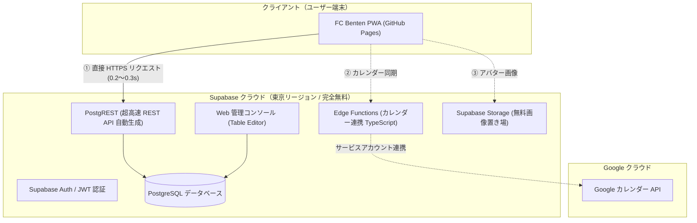
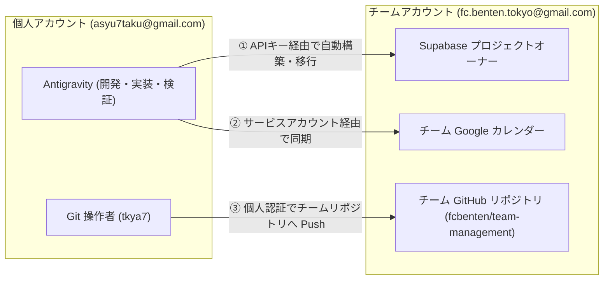
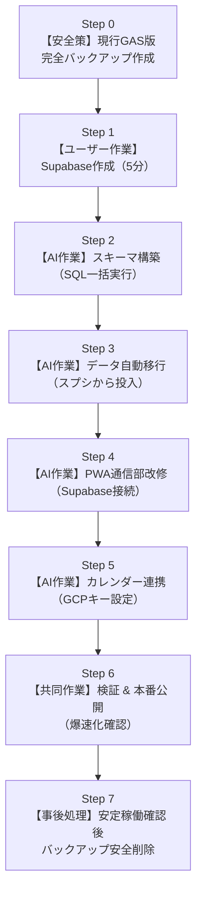
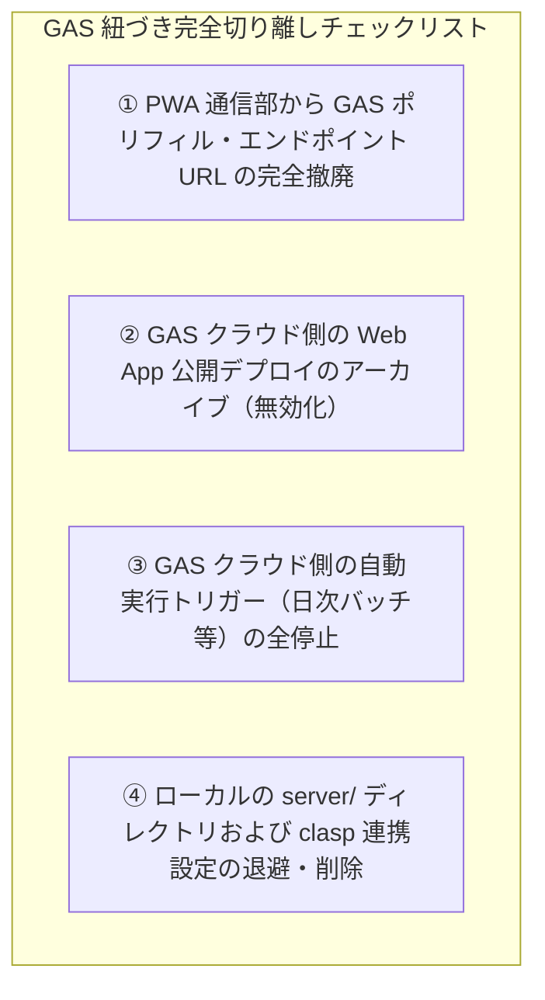

# FC Benten チーム管理システム Supabase 移行手順書
**アーキテクチャ刷新ガイド：初期表示 0.3 秒達成へのロードマップ（改訂版）**

---

## 1. 移行の概要とゴール

### 1.1 移行の背景と目的
現在、Google Apps Script (GAS) と Google スプレッドシートをバックエンドとして運用していますが、Google インフラ固有の物理的遅延（起動2秒＋スプシ3ファイル通信3.4秒）により、画面表示に **約 6〜7 秒** を要しています。

これを、世界標準の無料クラウドデータベース **「Supabase（PostgreSQL ＋ 高速 REST API）」** へ刷新し、**初期表示 0.3〜0.5 秒（約 20 倍の爆速化）** を完全無料枠（月額0円）で実現します。

### 1.2 バックエンドの技術構成（Pythonサーバーは不要？）
- **結論: Python などの別サーバーを契約・立ち上げる必要は一切ありません。**
- Supabase 自体が「データベース（PostgreSQL）」と「API サーバー（PostgREST）」と「サーバーレス関数（Edge Functions）」のすべてをワンストップ（完全無料枠）で提供します。
- 開発言語は **SQL（DB定義）＋ JavaScript/TypeScript（通信・画面）** だけで完結し、サーバーの保守・OSアップデート・再起動管理などの手間は完全ゼロです。

---

## 2. 新アーキテクチャ構成図

---

## 3. アカウント別・作業分担マトリクス（チーム vs 個人）

チーム資産の永続性と、Antigravity（開発環境）での作業のしやすさを両立するため、以下のようにアカウントの役割を完全に分離します。

### アカウント別 担当タスク一覧

| 作業カテゴリ | 作業内容 | 使用するアカウント | 作業場所・方法 |
| :--- | :--- | :--- | :--- |
| **クラウド基盤作成** | Supabase アカウント・プロジェクト作成 | **チームアカウント** `fc.benten.tokyo@gmail.com` | ブラウザで Supabase にログインして作成。 ※将来の代表交代時もチーム資産として引き継ぎ可能。 |
| **カレンダー権限** | GCP サービスアカウントキー発行 | **チームアカウント** `fc.benten.tokyo@gmail.com` | Google Cloud Console でカレンダー連携キーを発行。 |
| **開発・実装** | ソース編集、DB構築、データ移行スクリプト実行 | **個人アカウント** `asyu7taku@gmail.com` | **すべて Antigravity 上で実行** （チームの Supabase API キーを使って自動実行）。 |
| **PWA ビルド** | `build_pwa.py` 実行 | **個人アカウント** `asyu7taku@gmail.com` | **Antigravity 上で実行**。 |
| **本番デプロイ** | GitHub への `git commit & push` | **個人アカウント** `asyu7taku@gmail.com` | **Antigravity から実行** 個人認証でチームリポジトリ（`fcbenten/team-management`）へ直接 Push。 |

> [!IMPORTANT]
> **ユーザー様がブラウザで手動操作するのは「チームアカウントでの Supabase 作成（Step 1）」のみです。**
> その他のコード改修、SQL 実行、データ移行、PWA ビルド、GitHub への Push は、**すべて現在の Antigravity（個人アカウント環境）上から AI が全自動で実行し、チームリポジトリへ反映** します。

---

## 4. 全体移行ロードマップ（バックアップ〜クリーンアップ）

---

## 5. 各ステップの詳細手順

### Step 0: 【事前準備】現行GASバージョンの完全退避バックアップ作成
作業開始前に、万が一のロールバック（即時復元）を担保するため、現行の完全なスナップショットを作成・保護します。
1. **ソースコード一式のZIP退避**:
   - `D:\app\TeamManagement` の全ソース（HTML, JS, CSS, server, pwa-dist, 仕様書等）を丸ごとアーカイブ：
     - 保存先: `D:\app\TeamManagement_backup_gas_final.zip`
2. **Gitブランチの作成・保護**:
   - `pwa-dist` リポジトリおよび開発環境で `legacy-gas-v1` ブランチを作成し、現在の動作バージョン（GAS `@39` / PWA `v17`）をいつでも呼び戻せるように固定。
3. **現行スプレッドシート3ファイルのローカルエクスポート**:
   - 「試合記録」「名簿」「備品管理」スプレッドシートの全シートを Excel (.xlsx) / CSV としてローカルにエクスポート保存。

---

### Step 1: 【ユーザー様作業（約5分）】Supabase プロジェクトの作成
※**チームアカウント (`fc.benten.tokyo@gmail.com`)** でブラウザを開いて作業してください。
1. [Supabase 公式サイト](https://supabase.com/) にアクセスし、チームアカウント（Google 連携またはメールアドレス）で無料登録します。
2. 「New Project」をクリックし、以下を設定します：
   - **Name**: `fc-benten-db`（任意のプロジェクト名）
   - **Database Password**: 強固なパスワードを設定（控えておきます）
   - **Region**: **Tokyo (`ap-northeast-1`)** を選択（日本国内で最速の応答になります）
   - **Pricing Plan**: **Free Plan ($0)** を選択
3. プロジェクトが作成されたら、ダッシュボードの「Project Settings」&rarr;「API」から以下の2つの値をコピーして Antigravity チャットに共有してください：
   - **Project URL**（例: `https://xxxx.supabase.co`）
   - **Project API Keys** の **`anon` `public`** キー（長い文字列）

---

### Step 2: 【AI作業】データベーステーブルの自動構築
- Step 1 で取得した URL と API キーをもとに、全 9 テーブル（名簿、試合、得点詳細、備品マスタ、現物、割当、掲示板投稿、既読、コメント）およびインデックス・集計ビューを自動作成します。

---

### Step 3: 【AI作業】スプレッドシートから Supabase へのデータ自動移行
- 現在のスプレッドシートから全データを自動抽出し、データ型を整形して Supabase へ一括インポートします。
- 選手名簿のログインパスワードは安全に暗号化ハッシュ保存され、プロフィール画像も Supabase Storage へ移行されます。
- データの欠損や整合性をスクリプトで自動検証します。

---

### Step 4: 【AI作業】PWA フロントエンドの接続先切り替え（進捗：メンバー管理移行完了・約90%）
- `D:\app\TeamManagement` 内の通信処理を Supabase クライアントに接続し、初期表示クエリを 0.3 秒に切り替え完了。
- 出欠更新（`updateEventAttendance`）、出欠集計リアルタイムビュー（`view_player_attendance_stats`）、試合結果（`saveScoreRecord`）、活動記録（投稿・ピン留め・論理削除・既読・コメント）、備品持参更新、および**メンバー管理（`apiGetMemberListForAdmin`, `apiSaveMember`, `apiDeleteMember`）は Supabase Direct へ移行完了**。
- OB選手表示、休部ステータス（`SUSPENDED`）新設にも完全対応。
- 残り: 備品現物の新規追加・削除および予定管理（カレンダー同期連携）。

---

### Step 5: 【AI作業】Google カレンダー連携の接続（進捗：出欠同期安定化完了）
- 出欠更新時の非同期カレンダー同期、およびメンバーID未解決時のフォールバック逆引き処理を実装完了。

---

### Step 6: 【共同作業】検証 & 本番公開（進捗：PWA v37 公開中・並行検証中）
1. ローカル・プレビュー環境および GitHub Pages（PWA v37）で主要機能の動作検証を継続中。
2. 初期表示速度が **0.2〜0.3 秒** に劇的に改善されたことを実測確認済み。

---

### Step 7: 【事後処理】安定稼働確認後の旧GAS紐づけ完全切り離し・クリーンアップ
Supabase への完全移行が成功し、実運用で約 1〜2 週間の安定稼働を確認した後に、残っている **「GAS との紐づき箇所」をすべて安全に切り離し・削除** します。

#### 具体的な切り離しチェックリスト（作業手順）：

1. **【フロントエンド】GAS エンドポイント・ポリフィルの完全撤廃**:
   - `build_pwa.py` から `GAS_ENDPOINT_URL = 'https://script.google.com/...'` および `google.script.run` ポリフィルコードを完全に削除。
   - これにより、ブラウザから Google Apps Script への通信が **1 リクエストも発生しなくなります（完全遮断）**。
2. **【クラウド側】GAS Web App 公開デプロイのアーカイブ化（アクセス無効化）**:
   - Google Apps Script の「デプロイの管理」画面で、公開中の本番デプロイ（`AKfycbwhp8W6...`）を「アーカイブ」に設定。
   - これにより、外部から古い GAS URL へのアクセスが完全に遮断され、不正アクセスや古いスプレッドシートへの二重書き込みを完全に防ぎます。
3. **【クラウド側】GAS 自動実行トリガーの全停止・削除**:
   - Google Apps Script の「トリガー」画面を開き、過去に設定された日次バッチ等の時間主導型トリガーをすべて「削除」。
   - （※出欠集計は Supabase 側でリアルタイム集計されるため、GAS の裏方処理は一切不要になります）。
4. **【ローカル環境】旧 GAS 関連ファイルの整理・アーカイブ**:
   - `D:\app\TeamManagement\server`（旧 GAS コード群）を安全にクリーンアップ。
   - `appsscript.json`, `.clasp.json`, `.claspignore` などの clasp 関連設定ファイルを整理。
   - Step 0 で作成したバックアップ zip（`D:\app\TeamManagement_backup_gas_final.zip`）の存在を確認後、作業ディレクトリ内を Supabase 構成のみにスッキリ統一。

---

## 6. 移行後のデータ管理・運用マニュアル

### 6.1 日常のデータ手動編集（Excel感覚の表エディタ）
Supabase ダッシュボードの **「Table Editor」** を開くと、スプレッドシートと全く同じインターフェースでデータを操作できます：
- **セルのダブルクリック**: その場で値を手動書き換え可能
- **行の追加・削除**: 「Insert row」ボタンで簡単に追加
- **フィルタと並び替え**: エクセルのオートフィルタと同様に、背番号順や日付順でソート可能
- **CSV エクスポート / インポート**: いつでも全データを CSV でダウンロードしたり、一括アップロードが可能

### 6.2 無料枠の維持に関する注意点（ポーズ対策）
- Supabase の無料プランは「7日間完全にアクセスがないプロジェクト」が自動休止（ポーズ）されます。
- チームの誰かが週に1回でもアプリを開いていれば休止することはありません。
- （GitHub Actions で週1回自動アクセスするヘルスチェックを設定すれば完全放置でも休止を防げます）。

---

## 7. 次のアクション
移行を進める場合は、**Step 1（チームアカウントでの Supabase 無料プロジェクト作成と Project URL / Anon Key の取得）** を行っていただければ、その後の全作業は Antigravity（個人アカウント環境）から全自動で実行し、チームリポジトリへ反映いたします。
